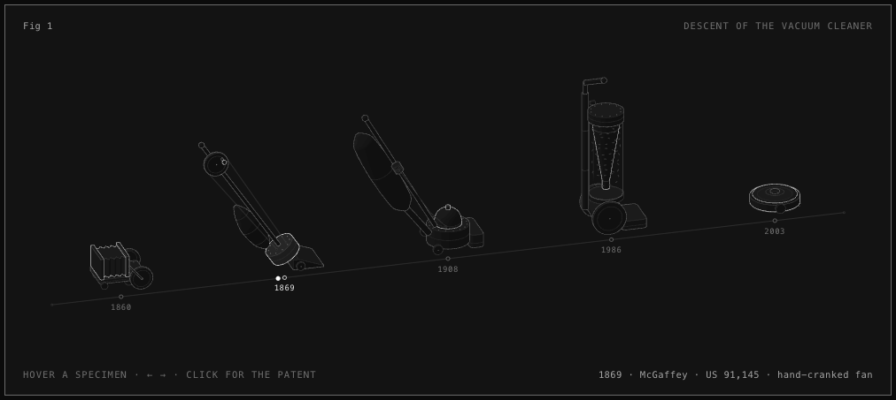
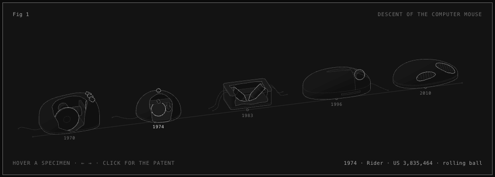
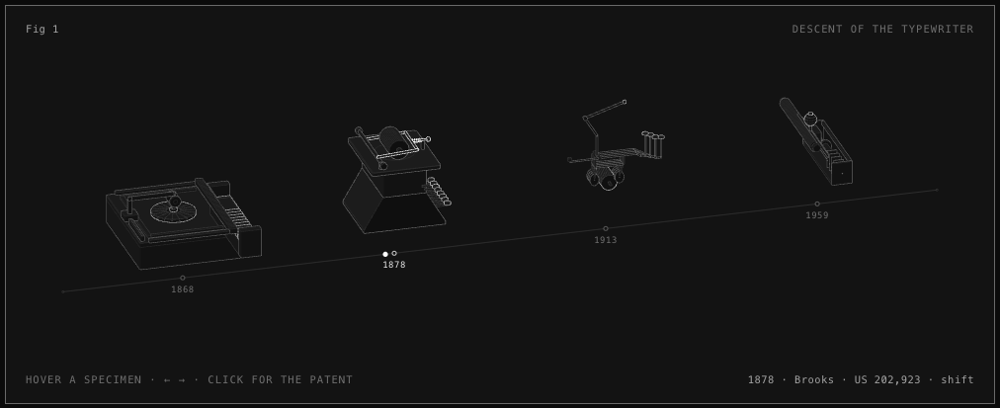
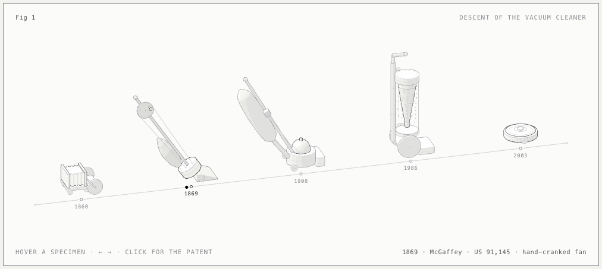

<h1 align="center">Patent lineage</h1>

<p align="center"><b>A Claude Code skill that draws how an object evolved, using its real patents.</b><br>Name a product. It finds the patented ancestors, checks every patent number, and draws each ancestor in a row from the oldest to the newest.</p>

<p align="center">
  <a href="https://code.claude.com/docs/en/skills"></a>
  <a href="LICENSE"></a>
  <a href="#requirements"></a>
  <a href="#requirements"></a>
</p>

<p align="center"></p>

## Built on Anatomy

This project is built on **[Anatomy](https://github.com/wheresryan22/anatomy)** by **Ryan ([@wheresryan22](https://github.com/wheresryan22))**. Anatomy is a Claude skill that explains an idea as a detailed, interactive isometric machine. The drawing kit, the visual style and the check scripts in this repository are Anatomy's, used without changes under its MIT license (see [LICENSE.anatomy](LICENSE.anatomy)). Patent lineage adds the patent research and the layout on top.

If you like the drawings, the credit is his. See Anatomy and his site: [skills.wheresryan.sh/anatomy](https://skills.wheresryan.sh/anatomy).

## What it does

```
/patent-lineage the vacuum cleaner
```

1. It finds candidate ancestors of the object from patent classes, citations and history.
2. It checks every patent on Google Patents: number, year, inventor and title. A patent that does not check out is not drawn.
3. It downloads the first drawing sheet of each patent and reads it.
4. It redraws each ancestor as an interactive isometric model in Anatomy's style. One part is lit: the part that the patent claimed as new.
5. It builds one HTML page with a timeline, the original drawing sheets and a link to every patent.

The result is a picture like the "march of progress" of human evolution. For the vacuum cleaner, the shape crouches, stands up and lies down again.

## Why patents

A patent has a date, a drawing and a description of what was new. So a figure built from patents can say what is true: this was patented in 1908, by this person, and this is what it added. Language models often invent plausible patent numbers, so the checker exists to catch that. In testing it caught a wrong patent number and a wrong inventor on the first try.

Captions always say "patented", never "invented".

## Examples

<table>
<tr>
<td width="50%"><br><sub><b>Computer mouse</b>: Engelbart 1970, Rider 1974, Kirsch 1983, Gillick 1996, Hotelling 2010. Inner parts are shown with cutaways. Drawn at 9 times life size.</sub></td>
<td width="50%"><br><sub><b>Typewriter</b>: Sholes 1868, Brooks 1878, Smathers 1913, Palmer (IBM) 1959. Burt's 1829 patent burned in a fire in 1836, so it is named in the caption and not drawn.</sub></td>
</tr>
<tr>
<td colspan="2"><br><sub><b>Vacuum cleaner</b> (the reference example, light theme): Hess 1860, McGaffey 1869, Spangler 1908, Dyson 1986, iRobot 2003.</sub></td>
</tr>
</table>

Build an example with Node. It writes standalone pages next to the script, and `--light` makes the light theme:

```sh
node examples/vacuum-cleaner/build.mjs
node examples/computer-mouse/build.mjs
node examples/typewriter/build.mjs
```

In a page, hover a model or press the arrow keys to move along the timeline. Click a model to open its patent. The `png` and `svg` buttons next to "Fig 1" download the figure with its title.

## Install

```sh
git clone https://github.com/cadeos/patent-lineage.git ~/.claude/skills/patent-lineage
```

Then ask Claude for the lineage of an object: `/patent-lineage the telephone`.

## Requirements

- Node.js 20.10 or later. There is nothing to install.
- Network access to `patents.google.com`.
- Google Chrome or Chromium for the checks. Set `CHROME_PATH` if it is not in the usual place.
- Optional: `pdftoppm` (from poppler), to read the first sheet of patents older than 1971 from the patent PDF.

## How the checking works

`scripts/verify-patents.mjs` reads `lineage.json` and checks each patent page for the number (design patents included), the year, the inventor or company and the title. Old patents have badly scanned text, so it also looks in the text of the patent. It saves the first drawing sheet of each patent that passed, and writes `lineage.verified.json`. The page builder refuses to run without that file.

If Google blocks your connection, the script says so and stops. It does not treat that as a wrong lineage. It waits between requests and keeps the pages it has already downloaded. Work on one object at a time. See `references/lineage.md`.

## What is in the repository

| Path | What it is |
|---|---|
| `SKILL.md` | The skill: the method, the layout rules and the steps. |
| `references/lineage.md` | Where ancestors come from, the JSON format, the rules for honest captions, limits. |
| `scripts/verify-patents.mjs` | The patent checker. |
| `scripts/patent-id.mjs` | Reads and formats patent numbers, design patents included. |
| `examples/` | Three finished lineages with their verified data, drawing sheets and built pages. |
| `kit/`, `scripts/capture.mjs`, `drive.mjs`, `lines.mjs` | The drawing kit and check scripts from Anatomy, unchanged. |
| `evals/evals.json` | Test prompts and what a good answer contains. |

## Roadmap

- A "bush" view. Evolution is a bush more than a march, so this would show dead branches off the main line.
- Patents from outside the US, through the EPO Open Patent Services.
- A stricter check of the drawing order for every model.
- Helpers for curved shells and cutaways in the kit.

## License

MIT. See [LICENSE](LICENSE). The kit and scripts from Anatomy keep its license: [LICENSE.anatomy](LICENSE.anatomy). The drawing sheets shown next to each model are reproduced from the published patent documents, via Google Patents. Check the reuse terms of the patent office before sharing them outside this repository.
